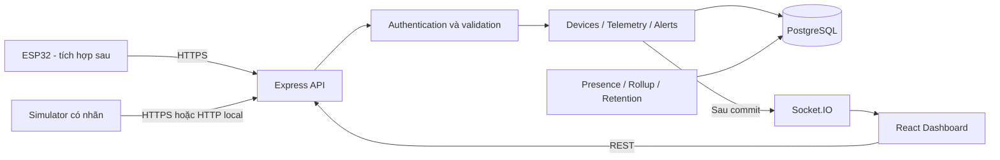
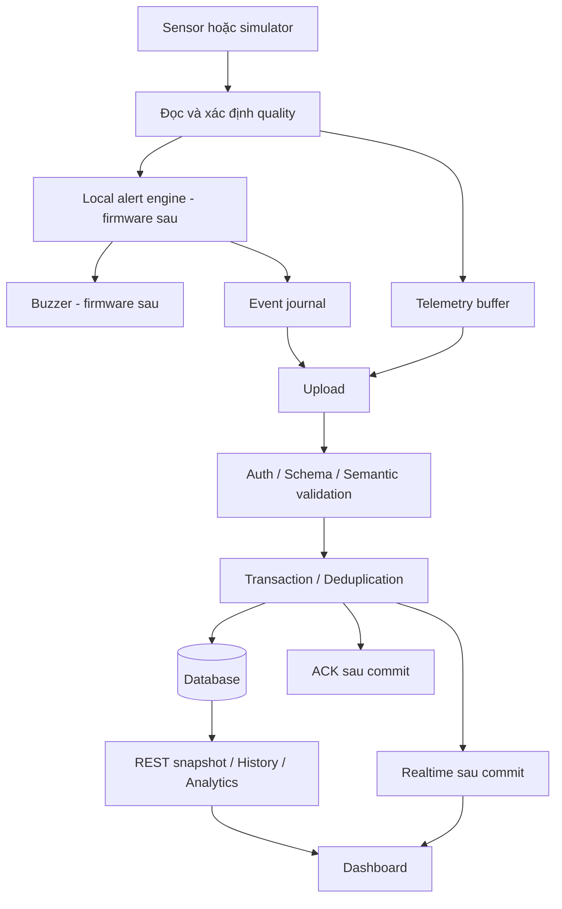
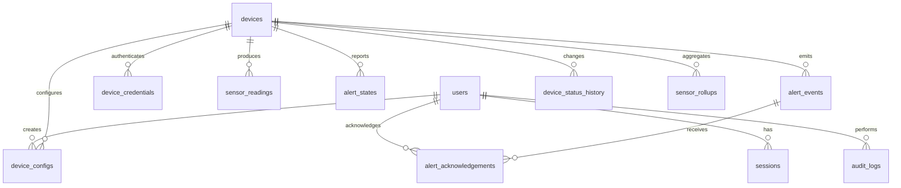
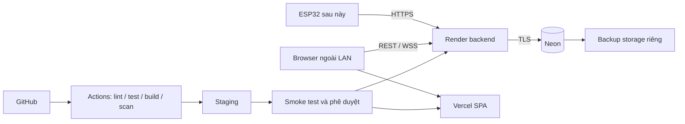
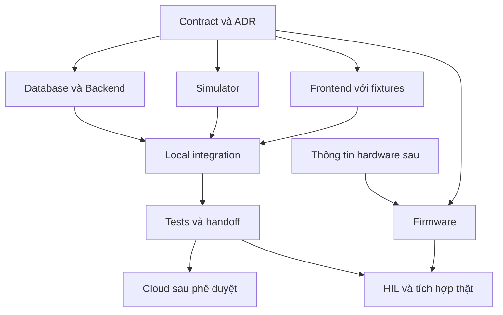

# MASTER IMPLEMENTATION PLAN

## Hệ thống IoT giám sát môi trường và cảnh báo khí gas

- Trạng thái: đang triển khai local; đã có lát cắt backend/database/dashboard/simulator đầu tiên. Xem README.md và docs/testing/status.md để biết phạm vi và bằng chứng kiểm thử.
- Phạm vi triển khai trước: backend + PostgreSQL + frontend + simulator, chạy local.
- Firmware và kiểm thử phần cứng: thực hiện sau khi người dùng cung cấp thông tin còn thiếu.
- Mục đích: nghiên cứu, học tập và trình diễn đồ án; không phải hệ thống an toàn sinh mạng đạt chứng nhận.
- Ngôn ngữ tài liệu/giao diện mặc định: tiếng Việt.

## 1. Yêu cầu và giới hạn

### 1.1. Chức năng

- Đăng nhập, xác thực phiên, phân quyền và đăng xuất.
- Quản lý thiết bị, metadata, credential, cấu hình và trạng thái kết nối.
- Nhận telemetry, validate, lưu database và xử lý bản ghi gửi lại.
- Cung cấp dữ liệu mới nhất, lịch sử, thống kê và export CSV.
- Lưu trạng thái cảnh báo, sự kiện bắt đầu/kết thúc và acknowledgement.
- Cập nhật dashboard bằng Socket.IO.
- Hiển thị online/offline, freshness và quality riêng biệt.
- Cung cấp simulator có nhãn rõ để phát triển trước firmware.
- Có migration, OpenAPI, logging, health checks và kiểm thử tự động.

### 1.2. Nguyên tắc bắt buộc

- Không quy đổi ADC thành PPM/AQI nếu chưa có phép đo và hiệu chuẩn hợp lệ.
- Không tự đặt ngưỡng nguy hiểm gas/CO thiếu căn cứ.
- Giá trị lỗi là `null` kèm quality, không thay bằng `0`.
- Không có dữ liệu không đồng nghĩa an toàn.
- Online không đồng nghĩa dữ liệu mới hoặc sensor hợp lệ.
- Acknowledge chỉ xác nhận đã xem, không kết thúc cảnh báo hoặc tắt còi.
- Cảnh báo cục bộ về sau phải độc lập backend và Internet.
- Không hiển thị dữ liệu mô phỏng như dữ liệu đo thật.
- Không hardcode secrets; không ghi credential vào log.
- Không tự triển khai cloud hoặc tạo tài khoản dịch vụ ngoài phạm vi được yêu cầu.
- Không tuyên bố đã kiểm thử nếu chưa thực sự chạy test.

### 1.3. Mục tiêu kỹ thuật đề xuất

| Thuộc tính | Mục tiêu và điều kiện |
| --- | --- |
| Chu kỳ truyền | Mặc định 5 giây, độc lập chu kỳ đo mới từng sensor |
| Realtime | P95 ≤ 2 giây từ DB commit đến UI khi backend warm, mạng ổn định |
| Ingestion | P95 ≤ 1 giây trong môi trường kiểm thử tải đã ghi cấu hình |
| Offline | Mặc định sau 30 giây không liên lạc; kiểm tra mỗi 5 giây khi server hoạt động |
| Idempotency | Một bản ghi cho một định danh mẫu |
| Quy mô kiểm thử | 10 thiết bị mô phỏng và 5 browser; ban đầu 1 ESP32 thật |
| Recovery | REST đối soát sau mất Socket.IO; không phụ thuộc realtime để bảo toàn dữ liệu |

Đây là mục tiêu cần đo, không phải kết quả đã đạt hoặc SLA của cloud free tier.

## 2. Thông tin đã biết và các quyết định còn mở

### 2.1. Phần cứng người dùng đã xác nhận

| Thành phần | Thông tin |
| --- | --- |
| ESP32 | DevKit dùng ESP32-WROOM-32D, không phải module rời |
| DHT11 | Module 3 chân; chờ xác nhận pinout/điện áp chính xác |
| MQ-2 | Module 4 chân, 5 V, AO/DO; nhà bán hàng mô tả AO đến 4,5 V |
| MQ-7 | Module 4 chân, 5 V, AO/DO; có heater bên trong sensor |
| Flame Sensor | Module AO/DO, trang bán hàng ghi 3,3–5 V |
| Buzzer | KY-012 active 3 chân, trang bán hàng ghi 5 V |

Heater có sẵn không chứng minh board tự điều khiển chu trình nhiệt. Sơ đồ MQ-7 được cung cấp không thể hiện bộ chuyển hai mức heater. Cần xác minh board thật trước khi nghiệm thu phép đo CO.

Nguồn tham chiếu do người dùng cung cấp:

- MQ-7: https://linhkienchatluong.vn/urlnuoc---khong-khi---bui/mq7---module-cam-bien-co-mq7_sp1671_ct159.aspx
- Datasheet được trang MQ-7 liên kết: https://www.pololu.com/file/0J313/MQ7.pdf
- Flame Sensor: https://linhkienchatluong.vn/urlmodule-cam-bien/module-cam-bien-lua-2-dau-ra-so-va-tuong-tu_sp1328_ct15301.aspx
- KY-012: https://linhkienchatluong.vn/urlmodule-audio/active-buzzer-module-ky-012---module-coi-bao_sp505_ct5064.aspx

### 2.2. Phương án mặc định cho công việc phần mềm

- HTTPS từ thiết bị đến backend; Socket.IO từ backend đến browser.
- Một nhóm quản lý chung; roles `admin`, `operator`, `viewer`.
- Không có public signup.
- Một ESP32 thật và các thiết bị simulator tách nhãn.
- Làm local trước, cloud sau khi luồng tích hợp local ổn định.
- Contract v1 là bản dự kiến, cần đối chiếu firmware trước khi khóa release tích hợp.
- Các lựa chọn trên là mặc định đề xuất, không phải xác nhận về cấu hình firmware thực tế.

### 2.3. Cần xác nhận trước các bước liên quan

- Ảnh/model DevKit, DHT11, nguồn cấp và thiết bị đo đang có.
- Pinout, dòng tải, đường mạch và cách điều khiển KY-012.
- MQ-7 giữ nguyên để thu raw hay bổ sung điều khiển heater và hiệu chuẩn.
- Chính sách cảnh báo gas/CO và điều kiện thử nghiệm có căn cứ.
- Đã xác nhận giữ đăng nhập qua reload: dùng cookie HttpOnly 8 giờ cho web local; custom domain/cookie policy cloud sẽ xác minh khi triển khai sau.
- Cloud demo theo phiên hay 24/7, ngân sách và tài khoản dịch vụ.
- Deadline, retention mong muốn và quyền truy cập từng thiết bị nếu không dùng nhóm chung.

Các điểm phần cứng chưa chốt không chặn backend/frontend/simulator.

## 3. Kiến trúc và công nghệ

### 3.1. Stack

| Lớp | Công nghệ |
| --- | --- |
| Firmware sau này | C++, Arduino Framework, PlatformIO, WiFiClientSecure, ArduinoJson |
| Backend | Node.js LTS, TypeScript strict, Express, Socket.IO, Zod |
| Database | PostgreSQL, Prisma, SQL migration bổ sung khi cần |
| Frontend | React, TypeScript, Vite, Tailwind CSS, Recharts, TanStack Query, React Router |
| Kiểm thử | Vitest, Supertest, Testing Library, Playwright; PlatformIO Unity cho firmware |
| Vận hành | Docker Compose, GitHub Actions; Render, Vercel, Neon khi được phép deploy |

Chốt phiên bản tương thích lúc scaffold, khóa bằng lockfile. Không tùy tiện đổi stack.

### 3.2. Kiến trúc lựa chọn

Monorepo, modular monolith backend, một PostgreSQL và một backend instance ban đầu. Không thêm Redis, broker hoặc microservices khi chưa cần.



HTTPS giảm thành phần vận hành cho một thiết bị. Nếu chuyển MQTT sau này, thêm transport adapter/subscriber; giữ nguyên services, database và dashboard. MQTT QoS không thay thế xác nhận DB commit, deduplication hoặc firmware buffer.

## 4. Data flow và tính đúng dữ liệu



### 4.1. Định danh và thời gian

- Unique sample: `(device_id, boot_id, seq)`.
- `boot_id`: UUID mới mỗi boot; bản thân UUID không biểu diễn thứ tự boot.
- Dự kiến thêm `boot_counter` lưu bền; cần chốt provisioning/reset semantics trước tích hợp thật.
- `seq`, `boot_counter`, `uptime_ms`: truyền chuỗi số nguyên khi cần tránh mất chính xác JavaScript.
- Retry giữ nguyên định danh và nội dung record.
- Cùng identity/cùng nội dung: duplicate thành công; khác nội dung: `409 IDENTITY_CONFLICT`.
- Hash record chuẩn hóa, không hash metadata thay đổi theo mỗi lần truyền.
- Lưu `sampled_at` nullable, `received_at` theo server, `uptime_ms`, `time_quality`.
- Timestamps UTC; UI chuyển timezone. Không giả `received_at` là thời điểm đo.
- Dữ liệu cũ có thể bổ sung lịch sử nhưng không làm lùi current state.
- Độ mới phải xét timestamp tin cậy hoặc sample age trong boot hiện tại; không coi backlog mới nhận là mẫu mới đo.

### 4.2. Connectivity và freshness

- `last_seen_at`: liên lạc hợp lệ gần nhất theo thời gian server.
- `offline_after = max(3 × reporting_interval, 30 giây)`.
- Online không chứng minh sensor hợp lệ.
- Freshness riêng từng sensor; không áp một thời hạn ngắn chung cho MQ-7 có chu kỳ heater.
- Backend restart phải reconcile presence từ DB.
- Browser mất backend hiển thị kết nối backend không xác định, không tự kết luận mọi thiết bị offline.

### 4.3. Alert lifecycle

- Tách `alert_states` hiện tại khỏi `alert_events` lịch sử.
- Trạng thái: `normal`, `active`, `unknown`, `not_configured`; quality như warming/fault lưu riêng.
- Event có `event_id`, `incident_id`, condition, transition, thời gian và ordering.
- Acknowledgement độc lập việc kết thúc incident.
- Không tự đóng alert vì mất mạng hoặc thiếu mẫu hợp lệ.
- Reboot không mặc nhiên chứng minh sự cố đã kết thúc.
- `buzzer_commanded_on` chỉ là lệnh firmware, không chứng minh còi phát âm.
- Bản đầu backend tiếp nhận trạng thái; không tự suy ra ngưỡng gas/CO.

## 5. Phần cứng và firmware: thiết kế dự kiến, chưa triển khai

### 5.1. GPIO dự kiến

| Tín hiệu | GPIO | Điều kiện |
| --- | --- | --- |
| MQ-2 AO | 34 / ADC1_CH6 | Qua signal conditioning/chia áp |
| MQ-7 AO | 35 / ADC1_CH7 | Qua signal conditioning/chia áp |
| DHT11 DATA | 18 | Pull-up không vượt 3,3 V |
| Flame DO | 27 | Ưu tiên cấp module 3,3 V; kiểm tra polarity |
| Buzzer driver | 25 | Qua driver nếu module không có input logic phù hợp |
| Heater control dự phòng | 26 / 23 | Chỉ dùng sau khi chốt mạch |

Ưu tiên ADC1 khi dùng Wi-Fi, tránh flash pins và strapping pins. Đối chiếu board thật trước đấu dây.

### 5.2. Nguồn và bảo vệ

- DevKit cấp qua đầu vào được board hỗ trợ; không cấp 5 V vào 3V3/GPIO.
- MQ heater không lấy từ chân 3V3.
- AO được mô tả đến 4,5 V không nối trực tiếp ADC ESP32.
- Cầu chia 15 kΩ phía AO / 10 kΩ xuống GND là ứng viên bench test: 5 V thành khoảng 2 V.
- Đánh giá ảnh hưởng cầu chia lên tải sensor, ADC settling, RC/buffer và back-power.
- KY-012 ba chân không mặc nhiên có driver hoặc chân IN dòng nhỏ; kiểm tra trước.
- Nguồn 5 V/2 A chỉ là ứng viên; chốt sau power budget và đo dưới tải.
- Nếu nguồn cảm biến riêng và ESP32 USB: nối GND chung; không tự nối hai nguồn 5 V với nhau.
- Linh kiện dự kiến: nguồn ổn định, điện trở chia áp, driver buzzer, tụ nguồn; heater driver nếu chọn hướng MQ-7 đầy đủ.

### 5.3. Firmware tương lai

- Tách local sensor/alert loop khỏi network worker.
- Kiểm tra sensor, filtering, chất lượng mẫu và sensor age.
- Wi-Fi reconnect, TLS hostname/CA verification, time sync.
- Không dùng `setInsecure()` trong production.
- Buffer giới hạn, backoff có jitter, timeout, watchdog và structured diagnostics.
- Telemetry buffer dự kiến 120 mẫu; batch tối đa 20 mẫu/64 KiB; phải benchmark RAM trước chốt.
- Event journal dự kiến 64 transition; đánh giá CRC, độ bền flash và hành vi overflow.
- Overflow phải tăng số đếm dữ liệu mất, không âm thầm báo đầy đủ.
- Mất điện có thể mất telemetry RAM; không cam kết lưu đủ nếu chưa có durable queue.
- Sensor warming/calibration và MQ-7 heater state phải trung thực với phần cứng thực tế.

## 6. Database design



### 6.1. Bảng và trường chính

| Bảng | Nội dung |
| --- | --- |
| `users` | UUID PK, email unique chuẩn hóa, password_hash, role, active, timestamps |
| `sessions` | UUID PK, user_id FK, token_hash unique, expires_at, revoked_at |
| `devices` | UUID PK, name, source_kind, metadata, last_seen_at, latest ordering, config versions |
| `device_credentials` | UUID PK, device_id FK, key_id unique, secret_hash, expiry/revoke |
| `device_configs` | UUID PK, device_id FK, version, JSONB config, hash, created_by FK |
| `sensor_readings` | BIGINT PK, device FK, boot/seq, times, numeric sensor columns, quality, payload_hash |
| `alert_states` | UUID PK, device FK, condition, state, incident_id, ordering, updated_at |
| `alert_events` | UUID PK, device FK, source_event_id, incident_id, transition, severity, times, evidence |
| `alert_acknowledgements` | UUID PK, event FK, user FK, timestamp; idempotent acknowledgement |
| `device_status_history` | BIGINT PK, device FK, previous/new status, effective_at, detected_at, reason |
| `sensor_rollups` | BIGINT PK, device FK, bucket, resolution, valid/invalid counts, aggregates |
| `audit_logs` | BIGINT PK, user FK nullable, action, resource, redacted metadata, timestamp |

Incident-level acknowledgement semantics cần được khóa trong contract; nếu xác nhận theo incident thì liên kết bằng incident identity thay vì chỉ một transition event.

### 6.2. Constraints và index

- UUID cho tài nguyên nghiệp vụ; BIGINT cho telemetry/history lớn.
- `TIMESTAMPTZ` UTC; °C, %RH, mV có tên trường rõ.
- Unique `(device_id, boot_id, seq)` và `(device_id, source_event_id)`.
- Unique config `(device_id, version)`; state `(device_id, condition)`.
- Unique rollup `(device_id, resolution, bucket_start)`.
- Index readings `(device_id, sampled_at DESC, id DESC)` và `(device_id, received_at DESC, id DESC)`.
- Index alerts/status theo device và thời gian; sessions theo expiry.
- Check ADC theo độ phân giải; humidity 0–100 khi có giá trị.
- Numeric hay dùng query là cột riêng; JSONB cho metadata linh hoạt.
- Archive device mặc định; không cascade xóa lịch sử tùy tiện.
- SQL migration cho partial index/constraint khi Prisma không biểu diễn đủ.

### 6.3. Retention và backup

Một thiết bị gửi mỗi 5 giây tạo 17.280 mẫu/ngày, khoảng 518.400 mẫu/30 ngày. Đo dung lượng row/index thực tế trước khi cam kết cloud quota.

| Dữ liệu | Retention dự kiến |
| --- | --- |
| Raw | 14 ngày |
| Rollup 1 phút | 90 ngày |
| Rollup 1 giờ | 12 tháng |
| Alerts/status | 12 tháng |
| Audit | 180 ngày |

- Chỉ xóa raw sau aggregation thành công; xử lý idempotent, theo batch.
- Không aggregate mẫu invalid; không trộn calibration/profile không tương thích.
- Gas raw không diễn giải thành nồng độ; flame thống kê event/duration thay vì đại lượng vật lý suy diễn.
- Chốt retry window hữu hạn, dự kiến 24 giờ, để tránh tái chèn sau retention; record không có giờ cần policy tuổi riêng.
- Backup mã hóa hàng ngày ra nơi lưu riêng, không lưu duy nhất trên Render filesystem.
- Đề xuất 7 bản ngày/4 bản tuần; RPO ≤24 giờ, RTO ≤4 giờ, phải restore drill.

## 7. REST API contract dự kiến

Prefix `/api/v1`. Authorization phải kiểm tra cả role và tài nguyên.

| Nhóm | Endpoints |
| --- | --- |
| Auth | `POST /auth/login`, `GET /auth/session`, `POST /auth/logout` |
| User | `GET/PATCH /users/me`, `PUT /users/me/password` |
| Admin users | `GET/POST /users`, `PATCH /users/:userId` |
| Devices | `GET/POST /devices`, `GET/PATCH /devices/:id` |
| Status | `GET /devices/:id/status-history` |
| Config | `GET/PUT /devices/:id/config` |
| Keys | `GET/POST /devices/:id/credentials`, `DELETE /devices/:id/credentials/:keyId` |
| Device upload | `POST /device/telemetry`, `POST /device/events`, `POST /device/heartbeat` |
| Device config | `GET /device/config`, `POST /device/config/ack` |
| Overview | `GET /overview` |
| Readings | `GET /devices/:id/readings/latest`, `GET /devices/:id/readings` |
| Analytics | `GET /devices/:id/analytics`, `GET /devices/:id/readings/export` |
| Alerts | `GET /alerts/states`, `GET /alerts/events`, `GET /alerts/events/:id` |
| Acknowledge | `POST /alerts/events/:id/acknowledgements` — chốt event/incident semantics |
| Health/docs | `GET /health/live`, `GET /health/ready`, `GET /openapi.json`, `GET /docs` |

### 7.1. Quy ước

- Success: `data`, `meta.request_id`, `meta.server_time`, cursor nếu có.
- Error: `error.code`, `error.message`, redacted details, request_id.
- HTTP: 200/201/204/304; 400/401/403/404/409/413/422/429/503 đúng nghĩa.
- Device identity trong body phải khớp credential; không dùng body để quyết định quyền.
- Batch validate trước, transaction trước ACK; response nhận diện từng sample đã lưu/duplicate.
- History cursor pagination, đề xuất tối đa 1.000 mẫu/page.
- Chart aggregation tối đa khoảng 2.000 điểm; CSV tối đa 100.000 dòng/request, có chống formula injection.
- Body limit 64 KiB cho upload dự kiến; rate limit hỗ trợ nhịp 5 giây và bounded backlog.
- `429` có `Retry-After`; `5xx`/timeout cho phép retry; `4xx` payload lỗi không retry vô hạn.

## 8. ESP32 payload contract v1 dự kiến

Header: `Authorization: DeviceKey <key_id>.<secret>`, `Content-Type: application/json`.

| Nhóm | Trường |
| --- | --- |
| Envelope | schema_version, device_id, transmission, readings[] |
| Transmission | current_boot_id, current_boot_counter, sent_uptime_ms |
| Record | boot_id, boot_counter, seq, sampled_at, uptime_ms, time_quality, firmware_version, config_version |
| DHT11 | temperature_c, humidity_pct, quality, age_ms |
| MQ-2/MQ-7 | adc_raw, adc_bits, adc_pin_mv, quality, age_ms, calibration_id, concentration_ppm nullable |
| MQ-7 bổ sung | measurement_valid, heater_control, heater_phase nếu thực sự biết |
| Flame | detected nullable, quality, age_ms |
| Alert snapshot | gas/co/flame state, policy_version, buzzer_commanded_on |
| Diagnostics | RSSI, free heap, queue depth, dropped records/events, reset reason |

Quy tắc:

- UUID hợp lệ, counter không âm có giới hạn, số hữu hạn.
- Schema version chưa hỗ trợ bị từ chối rõ ràng.
- Sensor lỗi dùng null/quality; không phát sinh giá trị giả.
- PPM null nếu thiếu calibration phù hợp; web không tự tính AQI.
- `adc_pin_mv` là điện áp tại chân ADC, không mặc định là AO trước chia áp.
- Event endpoint có event_id, incident_id, boot/event ordering, condition, transition, occurred_at/uptime, policy_version, evidence.
- Config có version/hash, desired/applied/rejected; firmware giữ quyền từ chối ngoài giới hạn local.
- Simulator source_kind được quản lý trên server, không tin nhãn tự khai từ payload.
- Ví dụ JSON/JSON Schema và fixtures phải được tạo trong bước contract, trước implementation consumer.

## 9. Socket.IO contracts

- Path `/socket.io`, namespace `/monitoring`.
- Auth bằng user session; không dùng device key hoặc token trong URL.
- Subscribe device IDs có kiểm tra quyền, server quản lý room.
- Envelope: version, event_id, type, emitted_at, device_id, data.

| Event | Chiều | Nội dung |
| --- | --- | --- |
| devices.subscribe / devices.unsubscribe | Client → server | device_ids; ACK accepted/rejected IDs |
| telemetry.created | Server → client | ID, boot/seq, values, quality, timestamps |
| device.status.changed | Server → client | old/new, last_seen, effective/detected time |
| alert.state.changed | Server → client | condition, state, incident, ordering |
| alert.event.created | Server → client | event/incident, transition, occurrence/receipt time |
| alert.acknowledged | Server → client | target, user, time |
| device.config.applied | Server → client | desired/applied version, result |
| resync.required | Server → client | lý do/refetch scope |

- Emit sau commit; Socket.IO không phải durable log.
- Reconnect: subscribe lại, fetch snapshot/history, dedup bằng IDs và ordering.
- Đối soát REST định kỳ khi tab hoạt động; không append backlog như current reading.
- Session hết hạn/revoke phải ngắt socket.
- Chưa thêm outbox; REST phục hồi dữ liệu. Nếu cần notification có bảo đảm chuyển phát thì đánh giá outbox riêng.

## 10. Frontend sitemap và UX

| Route | Nội dung |
| --- | --- |
| /login | Đăng nhập, validation, session expiry |
| /app/overview | Tổng thiết bị, online/offline, active alerts, dữ liệu thiết bị được chọn |
| /app/monitoring/:deviceId | Sensor cards, rolling charts, realtime, freshness, quality |
| /app/analytics | Khoảng thời gian, bucket, min/max/average phù hợp, so sánh, CSV |
| /app/alerts | Active/ended, acknowledgement, filter, timeline |
| /app/alerts/:eventId | Chi tiết sự kiện/sự cố |
| /app/devices | Danh sách, firmware, last seen, source_kind |
| /app/devices/:deviceId | Metadata, diagnostics, config, credential metadata |
| /app/settings | Profile, appearance, timezone, policy được phép |

UX bắt buộc:

- Responsive desktop/tablet/mobile, sidebar, dark/light mode.
- Skeleton, empty/error states, toast, keyboard focus, không chỉ dùng màu để báo trạng thái.
- Nhãn simulator rõ trên cards/charts/export; không tạo số liệu khi chưa có dữ liệu.
- Stale hiển thị tuổi mẫu; invalid tạo gap, không biến thành zero/normal.
- Nhiều thiết bị phải xác định nguồn từng chỉ số, không lấy ngẫu nhiên một sensor làm chỉ số toàn hệ thống.
- TanStack Query quản lý server state; một socket client ở app shell.
- Query keys rõ, invalidate/update có dedup, giới hạn chart points, lazy-load phần nặng.
- Không render HTML tùy ý từ metadata; CSV giữ quality, unit, timestamps và source.

## 11. Cấu trúc project và ownership

```text
iot_gas_monitor/
├── PLAN.md
├── README.md
├── package.json / lockfile / tsconfig.base.json / lint-format config
├── apps/
│   ├── api/
│   │   ├── src/
│   │   │   ├── config/ middleware/ lib/
│   │   │   ├── modules/auth/ users/ devices/ credentials/
│   │   │   ├── modules/telemetry/ alerts/ analytics/
│   │   │   ├── realtime/ jobs/
│   │   │   └── app.ts / server.ts
│   │   └── tests/unit/ integration/
│   └── web/
│       ├── src/app/ routes/ components/ lib/ styles/
│       ├── src/features/auth/ overview/ monitoring/
│       ├── src/features/analytics/ alerts/ devices/ settings/
│       └── tests/
├── packages/
│   ├── contracts/src/ fixtures/ generated/
│   └── database/prisma/migrations/ src/ tests/
├── tools/device-simulator/src/ scenarios/
├── tests/e2e/ contract/ load/ security/ hardware/
├── firmware/                    # phase sau
├── infra/compose/ render/ vercel/ backup/
├── docs/architecture/ hardware/ api/ deployment/ security/ operations/ testing/
└── .github/workflows/
```

| Owner logic | Phạm vi |
| --- | --- |
| Contract/Architect | packages/contracts, architecture |
| Database | packages/database, migration |
| Backend | apps/api |
| Frontend | apps/web |
| QA | simulator, tests dùng chung |
| Firmware | firmware, hardware docs ở phase sau |
| DevOps | infra, workflows |
| Integrator | root config, lockfile, contract/migration review |

Có thể giao agent độc lập theo ranh giới trên khi được yêu cầu. Không nhiều owner cùng sửa lockfile/schema/contract; generated files không sửa tay. Thay đổi contract qua review và cập nhật consumer có kiểm thử.

## 12. Security architecture và threat model

### 12.1. Authentication

- Password Argon2id, tham số benchmark, không có mật khẩu mặc định public.
- Admin bootstrap qua quy trình riêng.
- Session web hiện dùng opaque token trong cookie HttpOnly, SameSite=Lax, host-only, TTL 8 giờ; DB chỉ giữ token hash; không localStorage. Refresh tự khôi phục qua session endpoint.
- Secure bật với HTTPS/production; request ghi cần custom anti-CSRF header và Origin allowlist. Chỉ HTTP loopback cho local development; same-site domain/cloud sẽ chốt sau.
- Không tự thay session model sau khi UI/API đã phụ thuộc.
- Role admin/operator/viewer; revoke/expiry áp dụng cho API và sockets.
- Device secret entropy cao, hash trong DB, trả plaintext một lần, hỗ trợ rotate/revoke.

### 12.2. Threat model

| Bề mặt | Nguy cơ | Kiểm soát |
| --- | --- | --- |
| ESP32 | Lộ key qua flash/debug | Key riêng, provision ngoài source, revoke; hardening sau |
| Wi-Fi/Internet | MITM | TLS CA/hostname verification; không setInsecure |
| Device API | Giả thiết bị, replay | Credential scope, dedup, ordering, retry window |
| API | IDOR, vượt quyền | RBAC và resource checks ở service |
| Input | SQLi, payload lớn/sai | Zod, body limits, parameterized queries |
| Login | Brute force | Rate limit theo IP/account, log đã redaction |
| Browser | XSS/token theft | React escaping, CSP, không HTML tùy ý |
| Socket | Join room trái phép, session hết hạn | Auth, Origin check, room authorization, disconnect |
| DB | Credential lộ, quyền quá lớn | TLS verify, runtime role tối thiểu, migration role riêng |
| Config | Tắt bảo vệ từ xa | Allowlist, local bounds, version/hash, audit |
| CI/dependencies | Supply chain, secret leak | Lockfile, scanning, least privilege, không secrets cho untrusted PR |
| Backup | Lộ hoặc không restore được | Mã hóa, quyền riêng, restore drill |

- CORS allowlist cụ thể; CORS không thay authentication. Staging preview có origin policy riêng.
- Cấu hình trust proxy đúng nền tảng để rate limit không bị sai.
- Log JSON, request_id, redact Authorization/password/token/DB URL.
- Local DB nằm trong Docker network, port host nếu cần chỉ loopback.
- Browser/ESP32 không truy cập DB trực tiếp.
- Không gọi Neon free là private database nếu chưa có private networking/IP restrictions tương ứng.

## 13. Local và cloud deployment

### 13.1. Local trước

1. Scaffold monorepo, env examples không secrets.
2. Compose PostgreSQL; backend/frontend tùy workflow development.
3. Migration và admin bootstrap.
4. Chạy simulator đã đăng ký riêng.
5. Kiểm thử local từ ingestion đến dashboard.
6. Ghi README có cách reset dữ liệu test an toàn và lệnh test.

### 13.2. Cloud sau phê duyệt



- Tách env/DB/credential local, staging, production.
- Render và Neon chọn region phù hợp; runtime pooled connection, migration connection theo driver.
- Migration chạy một lần có kiểm soát, ưu tiên expand–contract.
- SPA route fallback, CORS, security headers, health/live và health/ready.
- Không dùng filesystem Render cho dữ liệu bền.
- Cloud deployment và sử dụng tài khoản ngoài chỉ thực hiện khi được yêu cầu.

### 13.3. Free tier và vận hành

- Render free có cold start/spin-down, restart, quota giờ/bandwidth/build; không có SLA cho demo.
- Neon scale-to-zero không tiết kiệm khi query mỗi 5 giây; compute có thể chạy liên tục.
- Ví dụ 0,25 CU chạy 30 ngày: khoảng 180 CU-hours; phải đối chiếu quota hiện hành.
- Staging/production có thể chia sẻ quota theo account/workspace.
- Socket.IO reconnect và REST resync bắt buộc; server ngủ thì presence job không chạy đúng lịch.
- Vercel host SPA, không đặt Socket.IO server vào serverless frontend.
- Kiểm tra lại pricing/limits chính thức lúc deploy, không xem số liệu đã tra cứu là cam kết cố định.
- Theo dõi ingestion errors/latency, DB pool/errors, sockets, queue/drop counts, quota và backup age.

## 14. Kế hoạch kiểm thử và tiêu chí nghiệm thu

Áp dụng test-first/TDD cho feature và bugfix khi implementation. Load skill hướng dẫn phù hợp trước viết code; unit test không thay integration/HIL.

| ID | Thử nghiệm | Kết quả mong đợi |
| --- | --- | --- |
| AC01 | Simulator 60 phút, chu kỳ 5 giây | Không trùng; ≥99% mẫu nhận trong điều kiện mạng ổn định |
| AC02 | Đo ≥1.000 update | DB commit → UI P95 ≤2 giây khi warm |
| AC03 | Invalid/null/out-of-range | Validate đúng; UI không giả zero/normal |
| AC04 | Retry 100 lần một mẫu | Một row, không nhân alert |
| AC05 | Cùng identity khác nội dung | 409 conflict |
| AC06 | Batch out-of-order, boot cũ | History đúng; current state không lùi |
| AC07 | DB unavailable | 503, không ACK chưa commit |
| AC08 | Key sai/revoke, Device A giả B | Từ chối, không ghi dữ liệu |
| AC09 | Viewer sửa config/key | Từ chối đúng quyền |
| AC10 | Dừng thiết bị T=5 giây | Offline khoảng 30–35 giây khi server hoạt động |
| AC11 | Backend restart | Reconcile status từ DB |
| AC12 | Ngắt socket rồi reconnect | Refetch đúng, không mất/nhân current state |
| AC13 | Acknowledge | Lưu user/time, không tắt còi/đóng incident |
| AC14 | Simulator cùng thiết bị thật | Nhãn mô phỏng rõ trong UI/export |
| AC15 | Export invalid/stale | Đúng unit, source, timestamps, quality; chống CSV formula injection |
| AC16 | 10 simulator, 5 browser trong 30 phút | Ingestion P95 ≤1 giây trên môi trường đã ghi cấu hình |
| AC17 | Soak 24 giờ | Không crash hoặc tăng bộ nhớ không giới hạn |
| AC18 | Backup restore vào DB biệt lập | Kiểm tra schema/counts/chức năng; mục tiêu RPO/RTO đạt |
| AC19 | Deploy từ mạng Internet khác | HTTPS, auth, history, realtime hoạt động |
| AC20 | Chưa calibration | Không PPM/AQI; gas/CO không bị coi normal nếu chưa cấu hình |

Các bài hardware/firmware chỉ thực hiện ở phase sau:

- Wi-Fi/API lỗi không chặn local monitoring.
- Flame input hợp lệ → buzzer command ≤500 ms, kể cả mất Internet.
- Heater voltage/timing đúng datasheet đúng linh kiện.
- TLS sai CA/hostname bị từ chối.
- Power-cycle, watchdog, overflow, durable event recovery được đo.
- Gas/CO thực tế chỉ nghiệm thu khi có phần cứng, hiệu chuẩn, policy và phương pháp thử phù hợp.

Mỗi báo cáo test ghi version/commit, môi trường, input, expected/actual, logs và pass/fail. Kết quả thực thi được ghi riêng tại docs/testing/status.md; không coi danh sách AC này là các mục đã hoàn thành.

## 15. Roadmap và task backlog

Effort là ngày công kỹ thuật 8 giờ, ước lượng sơ bộ; chưa gồm mua hàng/aging và dự phòng. P0: nền tảng/chặn nghiệm thu; P1: chức năng bắt buộc; P2: bổ sung.

### Phase 1 — Contract và nền tảng

- Objective/scope: chốt software baseline, thiết lập local development.
- Dependencies: kế hoạch được duyệt; auth UX chốt trước task auth.
- Deliverables: contract v1, schema, scaffold, Compose, CI cơ bản.
- Acceptance/DoD: contract fixtures được validate, DB migrate được, build/test skeleton chạy được.
- Risks: thay contract, session chưa chốt.

| ID | Task | Priority | Ngày | Dependency |
| --- | --- | --- | --- | --- |
| P01 | Chốt ADR giao thức/session, roles, ordering, incident semantics | P0 | 1 | Phê duyệt phạm vi |
| P02 | Zod/JSON contracts, OpenAPI baseline, fixtures | P0 | 1,5 | P01 |
| P03 | Scaffold monorepo, strict TS, lint/format | P0 | 1 | P01 |
| P04 | Compose, env validation, CI checks | P0 | 1 | P03 |
| P05 | DB schema, migrations, constraint tests | P0 | 1,5 | P02, P04 |

### Phase 2 — Backend và simulator

- Objective/scope: API đúng dữ liệu, có xác thực và mô phỏng đầu-cuối.
- Dependencies: contracts/schema; task độc lập triển khai song song được.
- Deliverables: ingestion, alert/presence, queries, simulator.
- Acceptance/DoD: API/DB/socket integration tests pass, duplicate/out-of-order/error handling đúng.
- Risks: race condition, backlog được hiểu nhầm là current, alert semantics lệch.

| ID | Task | Priority | Ngày | Dependency |
| --- | --- | --- | --- | --- |
| B01 | Auth/session/RBAC, admin bootstrap | P0 | 1,5 | P01, P05 |
| B02 | Devices, keys, rotate/revoke, config | P0 | 1,5 | B01 |
| B03 | Ingestion/batch/transaction/dedup/ordering | P0 | 2 | B02, P02 |
| B04 | Alert state/events/acknowledgement | P0 | 1,5 | B03 |
| B05 | Presence/restart reconciliation/history | P0 | 1 | B03 |
| B06 | Latest/history/analytics/CSV | P1 | 1,5 | B03 |
| B07 | Socket auth/rooms/events/session revoke | P1 | 1 | B01, B04, B05 |
| B08 | Rollup/retention, logging/limits/OpenAPI completion | P1 | 1,5 | B04–B07 |
| S01 | Simulator và fault scenarios có nhãn | P0 | 1,5 | P02, P03 |

### Phase 3 — Frontend Dashboard

- Objective/scope: sáu màn hình, realtime, chất lượng dữ liệu, quản trị.
- Dependencies: contract; UI bắt đầu cùng backend qua fixtures/simulator.
- Deliverables: React dashboard responsive, component/E2E integration.
- Acceptance/DoD: loading/empty/error/stale/simulator states đúng, permission flows đúng.
- Risks: cache lệch, chart quá tải, dữ liệu thiếu bị hiển thị an toàn.

| ID | Task | Priority | Ngày | Dependency |
| --- | --- | --- | --- | --- |
| W01 | Shell/routes/theme/UI primitives | P1 | 1 | P02, P03 |
| W02 | Auth/API client/query keys | P0 | 1 | P01, W01 |
| W03 | Overview/cards/quality/freshness | P1 | 1,5 | W01, P02 |
| W04 | Monitoring/chart/socket/resync | P1 | 1,5 | W02, W03, B07 |
| W05 | Analytics/comparison/export | P1 | 1 | W03, B06 |
| W06 | Alerts/detail/ack | P1 | 1 | W02, B04 |
| W07 | Devices/credentials/config | P1 | 1 | W02, B02 |
| W08 | Settings/accessibility/component tests | P1 | 1 | W03–W07 |

### Phase 4 — Kiểm thử tích hợp và local handoff

- Objective/scope: chứng minh software chạy với simulator, tài liệu tái tạo được.
- Dependencies: backend/frontend tích hợp.
- Deliverables: E2E/fault/load/security report, README, local runbook.
- Acceptance/DoD: AC phần mềm P0/P1 pass hoặc blocker được công bố; không tự nhận HIL pass.
- Risks: lỗi tích hợp, hiệu năng và restore chưa được thử.

| ID | Task | Priority | Ngày | Dependency |
| --- | --- | --- | --- | --- |
| Q01 | API/DB/Socket/fault integration suite | P0 | 1,5 | B08, S01 |
| Q02 | Playwright E2E và authorization tests | P0 | 1,5 | W08, Q01 |
| Q03 | Load/soak/security scan, fix findings | P0 | 1,5 | Q02 |
| Q04 | README/OpenAPI/runbook/test report | P1 | 1 | Q01–Q03 |

### Phase 5 — Cloud, sau yêu cầu triển khai

- Objective/scope: staging/production demo với bảo mật và recovery.
- Dependencies: cloud accounts/budget/domain/session decisions, local handoff.
- Deliverables: deployments, CI release, backup/monitoring.
- Acceptance/DoD: Internet smoke, auth/realtime, backup restore có bằng chứng.
- Risks: quota/cold start, migration, cross-origin auth.

| ID | Task | Priority | Ngày | Dependency |
| --- | --- | --- | --- | --- |
| C01 | Neon/Render staging, migration workflow | P1 | 1 | Q04, phê duyệt cloud |
| C02 | Vercel/routes/CORS/TLS/session config | P1 | 1 | C01 |
| C03 | Backup/restore/quota/log/health | P0 | 1,5 | C01 |
| C04 | Release approval, Internet smoke/runbook | P0 | 1 | C02, C03 |

### Phase 6 — Firmware và hardware integration, chờ thông tin

- Objective/scope: ESP32 thật, sensor/buzzer, transport và fault recovery.
- Dependencies: xác minh hardware, chốt capability/alert policy và MQ-7 scope.
- Deliverables: firmware, wiring/BOM, provisioning, bench/HIL report.
- Acceptance/DoD: local alarm độc lập mạng; telemetry đúng contract; gas/CO chỉ nghiệm thu nếu đủ căn cứ.
- Risks: điện áp/nguồn, heater, sai số sensor, thiếu điều kiện hiệu chuẩn.

| ID | Task | Priority | Ngày | Dependency |
| --- | --- | --- | --- | --- |
| F01 | Xác minh board/pinout/nguồn, chốt BOM/wiring | P0 | 1–2 | Người dùng cung cấp hardware |
| F02 | Sensor drivers/filter/quality/local buzzer | P0 | 3–4 | F01 |
| F03 | MQ-7 heater/calibration/policy, nếu trong scope | P0 | Chưa chốt | F01, điều kiện thử |
| F04 | TLS/provisioning/time/queue/retry/watchdog | P0 | 3–4 | F02, P02 |
| F05 | HIL/power/network faults/integration report | P0 | 2–3 | F04, F03 nếu áp dụng |

Ước lượng phần mềm local P01–Q04: khoảng 34 ngày công, chưa dự phòng. Cloud thêm khoảng 4,5 ngày công. Firmware chưa thể chốt tổng effort trước khi xác minh MQ-7 và hardware. Dự phòng phần mềm 20–30%; không đồng nhất ngày công với thời gian lịch khi làm song song.



## 16. Risk register và cổng hoàn thành

| Rủi ro | Phương án |
| --- | --- |
| Firmware đổi payload | Contract version, shared fixtures, adapter boundary |
| Chưa xác minh MQ-7 heater/calibration | Nullable quality, không PPM, block nghiệm thu CO thật |
| GPIO nhận 5 V hoặc nguồn yếu | Chỉ đấu sau kiểm tra và signal conditioning |
| KY-012 không có input logic | Xác minh pinout/dòng, driver riêng nếu cần |
| Trùng/sai thứ tự | Unique constraint, transaction, ordering tests |
| Backend/socket lỗi | DB source of truth, retry và REST resync |
| Free tier không đủ 24/7 | Đo usage, demo theo phiên hoặc budget trả phí |
| Session UX chưa chốt | Chốt trước auth, không âm thầm chọn persistent storage kém an toàn |
| Agent sửa chung file | Ownership, integrator, contract/migration review |
| Backup không restore được | Restore drill và evidence |
| Simulator bị hiểu là số đo thật | Server-managed source_kind và nhãn xuyên suốt |

Cổng hoàn thành:

1. G1: contract/ADR/schema được khóa cho software v1.
2. G2: local backend + database + simulator hoạt động và có test.
3. G3: dashboard realtime/history/alerts tích hợp và có test.
4. G4: local handoff có tài liệu và giới hạn được công bố.
5. G5: cloud chỉ sau phê duyệt và smoke/recovery tests.
6. G6: hardware/firmware chỉ sau xác minh; HIL riêng, không suy từ simulator.

## 17. Definition of Done chung

- Đúng phạm vi, naming và module boundaries.
- Có test trước implementation cho logic mới/bugfix và kết quả test thực chạy.
- Lint/typecheck/build/tests tương ứng pass; ghi rõ test chưa chạy và nguyên nhân.
- Không secrets trong source/log/fixture.
- Contract/OpenAPI/README cập nhật theo hành vi thật.
- Error/loading/empty/stale/invalid/unauthorized được xử lý.
- Không fake implementation được gắn nhãn tính năng production.
- Không thay đổi hoặc triển khai cloud ngoài quyền đã cấp.
- Các giới hạn firmware, đo lường và hosting được ghi rõ.

## Bước tiếp theo

Đã bắt đầu implementation theo yêu cầu người dùng, chỉ local, không cloud. Lát cắt hiện tại: contracts, migration, auth/RBAC, devices/keys, ingestion/idempotency/ordering, history cursor, Socket.IO, simulator và dashboard cơ bản. Tiếp theo hoàn thiện incident/event history và acknowledgement, analytics/export, cấu hình, retention và các task còn lại. Firmware tiếp tục hoãn đến khi có thông tin. Không đánh dấu toàn bộ phase/AC hoàn thành chỉ vì luồng cơ bản đã chạy.
